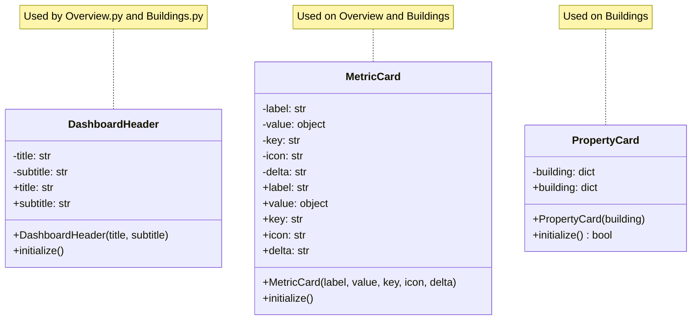
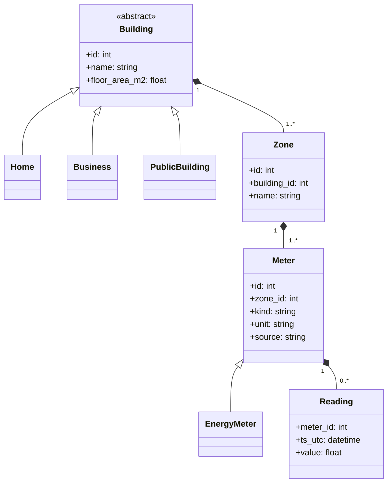

# AI-Powered Smart Energy Management System for German Properties

An academic capstone project focused on energy monitoring, consumption analysis, forecasting, and AI-assisted energy optimization for German properties.

## Project Overview

The project aims to develop a Python-based prototype that helps users understand electricity consumption patterns, explore historical energy data, forecast future demand, and obtain AI-assisted energy recommendations for German properties.

The prototype uses historical electricity data and analytical methods. It does not require physical energy meters or live IoT devices.

## Hometask 3 · Web APIs & Database Access Layers

The Flask/MySQL homework implementations are in `hometask_assignments/hometask3/`. The [assignment README](hometask_assignments/hometask3/readme.md) links both subsystem implementations.

Subsystem 2's data service serves our six buildings, their 15-minute readings and KPIs (energy, cost, CO2) from a MySQL copy of the building -> zone -> meter -> reading model. All SQL sits in `MySQLRepository`, which uses parameterized queries and is handed to `create_app()` by dependency injection. Endpoints: `/`, `/api/buildings`, `/api/buildings/<id>/readings`, `/api/buildings/<id>/kpis` and `POST /api/readings`. See [setup and database configuration](hometask_assignments/hometask3/subsystem2_flask/readme.md), then run:

```bash
python hometask_assignments/hometask3/subsystem2_flask/run.py
```

Open http://127.0.0.1:5000/.

Subsystem 3's energy advisor prototype stores daily energy summaries in a separate MySQL database. It displays them in an HTML table and exposes `/api/summaries` and `/api/advice/<building_id>`. Its database access layer uses parameterized queries. Advice is generated by a simple after-hours rule.

See [setup and database configuration](hometask_assignments/hometask3/subsystem3_advisor/readme.md), then run:

```bash
python -m hometask_assignments.hometask3.subsystem3_advisor.run
```

Open http://127.0.0.1:5002/. Subsystem 3's code, credentials template, schema, and dependencies are contained in its own homework folder.

## Project Objectives

- Analyze historical electricity consumption and energy-system data.
- Present energy-related insights through an interactive dashboard.
- Explore forecasting methods for identifying future consumption patterns.
- Develop an AI-assisted energy advisor for explaining analytical results and suggesting potential optimization strategies.
- Establish a modular and maintainable Python project structure.

## Project Scope

This project is an academic prototype for energy monitoring, forecasting, and AI-based optimization.

The initial scope includes:
- Historical data processing and validation.
- Exploratory energy data analysis.
- Forecasting experiments.
- Interactive reporting and visualization.
- AI-assisted explanations and recommendations.

Physical meter integration, live IoT monitoring, and production deployment are outside the initial scope.

## Team Overview

| Member | Matriculation number | Assigned subsystem |
|---|---:|---|
| Shreya Patil | 7226047 | 1 · Energy Dashboard & Reporting |
| Ourvish Lofur | 7226994 | 2 · Data Management & Energy Analytics |
| Joywin Bennis | 7225872 | 3 · AI Analyzer & Integration |

### Dashboard OOP implementation

The dashboard subsystem uses three UI classes in `src/ui/dashboard/components.py`:

| Class | Responsibility |
|---|---|
| `DashboardHeader` | Stores and renders a page title and subtitle. |
| `MetricCard` | Validates and renders a styled dashboard metric. |
| `PropertyCard` | Validates and renders a building card with a details action. |

Each class initializes state in `__init__`, exposes validated properties as getters/setters, and provides an `initialize()` method to render its UI. The Overview and Buildings pages use these classes to present consistent dashboard layouts.

## System Design

This GitHub-rendered UML class diagram describes the implemented dashboard components used by the Overview and Buildings pages:



The core project logic and data model are represented by the following UML class diagram, which models the energy domain and the SQLite-backed persistence layer used by the analytics functions:



The approved capstone UML diagrams for the complete system can be added here when available; the diagrams above document the implemented dashboard classes and the underlying energy domain model.

## Team Video Presentation

**Presentation link:** Pending team recording and upload. Add the direct YouTube, Loom, or Google Drive URL here when available.

## System Subsystems

### 1. Energy Dashboard & Reporting
**Implemented technologies:** Streamlit, Plotly

Responsible for presenting energy trends, analytical results, forecasts, and reporting visualizations.

### 2. Data Management & Energy Analytics
**Implemented technologies:** Python, Pandas, SQLite

Responsible for data preparation, validation, exploratory analysis, and supporting forecasting experiments.

### 3. AI Energy Advisor & Integration
**Planned technologies:** LangChain, OpenAI API, Docker

Responsible for AI-assisted interpretation of energy insights and potential energy-saving recommendations.

AI Advisor technologies remain planned; integration and compatibility will be verified as development progresses.

## Dataset

**Planned initial source:** Open Power System Data (OPSD), using relevant historical German electricity data.

The selected dataset and its columns will be reviewed before analysis begins. National electricity-system data represents broader electricity demand and is not automatically equivalent to an individual building's specific profile.

## Technology Stack

| Area | Technologies |
|---|---|
| Programming language | Python |
| Data processing | Pandas, NumPy |
| Visualization | Plotly |
| Dashboard | Streamlit |
| Machine learning | Scikit-learn |
| Statistical forecasting | Statsmodels |
| Configuration | python-dotenv |
| Planned AI integration | LangChain, OpenAI API |
| Current database | SQLite |
| Planned containerization | Docker |

## Repository Structure

```text
Capstone_project/
|-- .streamlit/
|   `-- config.toml
|-- src/backend/
|   |-- analysis/
|   |-- db/
|   |-- ingestion/
|   |-- models.py
|   `-- settings.py
|-- src/
|   |-- app.py
|   |-- styles/style.css
|   `-- ui/dashboard/
|       |-- components.py
|       |-- Overview.py
|       |-- Buildings.py
|       `-- *.py
|-- .env.example
|-- .gitignore
|-- pyproject.toml
|-- README.md
`-- requirements.txt
```

Local virtual environments, generated Python files, and downloaded datasets are excluded from version control.

## Development Environment

The project currently uses Python 3.14.7 in a repository-local virtual environment.

The initial data analysis, visualization, dashboard, forecasting, and configuration dependencies have been installed and tested for successful imports. Additional dependencies will be evaluated when the AI advisor and deployment work begin.

### Initial Setup

1. Clone the repository.
2. Open the project in PyCharm.
3. Create or select a local virtual environment.
4. Install the initial dependencies:

   ```bash
   python -m pip install -r requirements.txt
   ```

5. Verify dependency consistency:

   ```bash
   python -m pip check
   ```

### Run the Dashboard

From the project directory:

```bash
python -m streamlit run src/app.py
```

### Environment Variables

Copy `.env.example` to `.env` for local configuration when AI integration is introduced.

Add your own API credentials to `.env` only when needed. Never commit `.env` or expose API keys in source code.

## Visual Theme

The dashboard theme is **Midnight Blue + Sand + Bronze**.

| Color | Hex |
|---|---|
| Midnight Blue | `#1E3045` |
| Slate Blue | `#344B63` |
| Warm Sand | `#F3EADF` |
| Bronze | `#C09262` |
| Espresso Brown | `#49372B` |

The theme is applied across the Streamlit dashboard.

## Project Status

**Current phase:** Streamlit dashboard and SQLite-backed energy analysis prototype.

Completed:
- OPSD data ingestion and validation.
- SQLite persistence and Python analysis service layer.
- Streamlit dashboard pages and reusable UI component classes.
- Dashboard OOP class diagram.
- Energy domain model class diagram.

Next planned steps include automated tests, team UML consolidation, and the team presentation.

## Academic Use

This project is intended for educational and demonstration purposes. Forecasts and AI-generated recommendations should be evaluated against the available data and should not be treated as guaranteed real-world advice.
