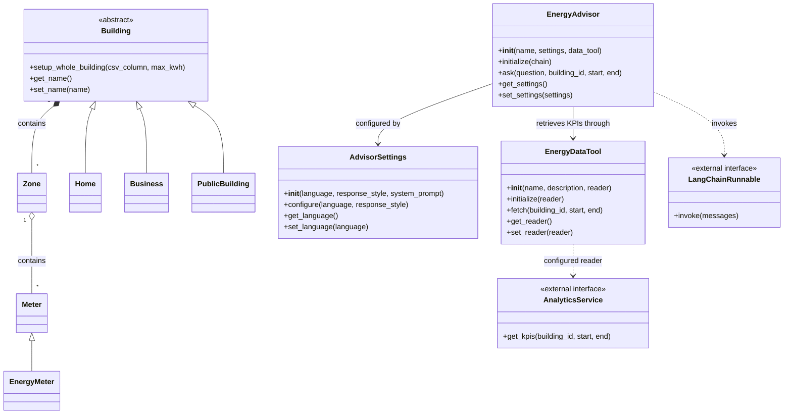

# AI-Powered Smart Energy Management System for German Properties

An academic capstone project focused on energy monitoring, consumption analysis, forecasting, and AI-assisted energy optimization for German properties.

## Hometask 1 · Object-Oriented Concepts

The OOP implementation is in `hometask_assignments/hometask1/` on branch `Homeassignment1`. See the [assignment README](hometask_assignments/hometask1/readme.md) for the subsystem layout and detailed class diagrams.

### Team overview

| Member | Matriculation number | Subsystem |
|---|---|---|
| Shreya Patil | 7226047 | 1 · Energy Dashboard & Reporting |
| Ourvish Lofur | 7226994 | 2 · Data Management & Energy Analytics |
| Joywin Bennis | 7225872 | 3 · AI Analyzer & Integration |

### System design



Ourvish's subsystem contains the data model: an abstract `Building` (with `Home`, `Business` and `PublicBuilding`) has `Zone`s, and a zone has `Meter`s (`EnergyMeter` for electricity). All attributes are private with getters/setters, the constructors call the setters, and `configure` / `setup_whole_building` are the setup methods. Its demonstration runs from the repository root:

```bash
python hometask_assignments/hometask1/subsystem2_data_analytics/demo.py
```

Joywin's subsystem contains three classes: `AdvisorSettings`, `EnergyDataTool`, and `EnergyAdvisor`. Each has a constructor, setup/configuration logic, and getters/setters. Its offline demonstration runs from the repository root:

```bash
python -m hometask_assignments.hometask1.subsystem3_ai.demo
```

### Presentation link

**Video:** [Hometask 1 presentation (Google Drive)](https://drive.google.com/file/d/1yi4dm8Y4fErex-7-d2I_7SP2XGJRgL6T/view?usp=drive_link)  
All team videos: [Google Drive folder](https://drive.google.com/drive/folders/1eVMkck2AjgFbLdQfN-eUD_lYISwNbn4x?usp=drive_link)

## Project Overview

The project aims to develop a Python-based prototype that helps users understand electricity consumption patterns, explore historical energy data, forecast future demand, and obtain AI-assisted energy-saving recommendations.

The prototype uses historical electricity data and analytical methods. It does not require physical energy meters or live IoT devices.

## Project Objectives

- Analyze historical electricity consumption and energy-system data.
- Present energy-related insights through an interactive dashboard.
- Explore forecasting methods for identifying future consumption patterns.
- Develop an AI-assisted energy advisor for explaining analytical results and suggesting potential optimization strategies.
- Establish a modular and maintainable Python project structure.

## Project Scope

This project is an academic prototype for energy monitoring, forecasting, and AI-based optimization.

The initial scope includes:
- Historical data processing and validation.
- Exploratory energy data analysis.
- Forecasting experiments.
- Interactive reporting and visualization.
- AI-assisted explanations and recommendations.

Physical meter integration, live IoT monitoring, and production deployment are outside the initial scope.

## Project Team

- Shreya Patil
- Joywin Bennis
- Ourvish Lofur

## System Subsystems

### 1. Energy Dashboard & Reporting
**Planned technologies:** Streamlit, Plotly

Responsible for presenting energy trends, analytical results, forecasts, and reporting visualizations.

### 2. Data Management & Energy Analytics
**Planned technologies:** Python, Pandas, PostgreSQL, Scikit-learn, Statsmodels

Responsible for data preparation, validation, exploratory analysis, and supporting forecasting experiments.

### 3. AI Energy Advisor & Integration
**Planned technologies:** LangChain, OpenAI API, Docker

Responsible for AI-assisted interpretation of energy insights and potential energy-saving recommendations.

These are planned subsystem technologies; integration and compatibility will be verified as development progresses.

## Dataset

**Planned initial source:** Open Power System Data (OPSD), using relevant historical German electricity data.

The selected dataset and its columns will be reviewed before analysis begins. National electricity-system data represents broader electricity demand and is not automatically equivalent to an individual property's consumption.

## Technology Stack

| Area | Technologies |
|---|---|
| Programming language | Python |
| Data processing | Pandas, NumPy |
| Visualization | Plotly |
| Dashboard | Streamlit |
| Machine learning | Scikit-learn |
| Statistical forecasting | Statsmodels |
| Configuration | python-dotenv |
| Planned AI integration | LangChain, OpenAI API |
| Planned database | PostgreSQL |
| Planned containerization | Docker |

## Repository Structure


```text
Capstone_project/
|-- .streamlit/
|   `-- config.toml
|-- src/
|   |-- app.py
|   |-- data/
|   |   |-- __init__.py
|   |   `-- loader.py
|   `-- ui/
|       |-- __init__.py
|       `-- dashboard/
|           |-- __init__.py
|           |-- *.py
|           `-- static/
|-- .env.example
|-- .gitignore
|-- pyproject.toml
|-- README.md
`-- requirements.txt
```

Local virtual environments, generated Python files, and downloaded datasets are excluded from version control.

## Development Environment

The project currently uses Python 3.14.7 in a repository-local virtual environment.

The initial data analysis, visualization, dashboard, forecasting, and configuration dependencies have been installed and tested for successful imports. Additional dependencies will be evaluated when their subsystems are developed.

### Initial Setup

1. Clone the repository.
2. Open the project in PyCharm.
3. Create or select a local virtual environment.
4. Install the initial dependencies:

   ```bash
   python -m pip install -r requirements.txt
   ```

5. Verify dependency consistency:

   ```bash
   python -m pip check
   ```

### Run the Dashboard

From the project directory:

```bash
python -m streamlit run src/app.py
```

### Environment Variables

Copy `.env.example` to `.env` for local configuration when AI integration is introduced.

Add your own API credentials to `.env` only when needed. Never commit `.env` or expose API keys in source code.

## Visual Theme

The planned dashboard theme is **Midnight Blue + Sand + Bronze**.

| Color | Hex |
|---|---|
| Midnight Blue | `#1E3045` |
| Slate Blue | `#344B63` |
| Warm Sand | `#F3EADF` |
| Bronze | `#C09262` |
| Espresso Brown | `#49372B` |

The theme is documented here for consistency; dashboard UI implementation will follow once the project is ready for that stage.

## Project Status

**Current phase:** Repository setup and environment validation.

Completed:
- Initial repository structure.
- Python package initialization files.
- Git ignore rules and environment template.
- Initial dependency installation and import checks.
- Local interpreter configuration in PyCharm.

Next planned steps include project metadata, dataset assessment, data processing design, and subsystem development.

## Academic Use

This project is intended for educational and demonstration purposes. Forecasts and AI-generated recommendations should be evaluated against the available data and should not be treated as guaranteed energy savings.
