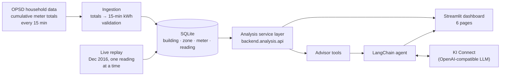
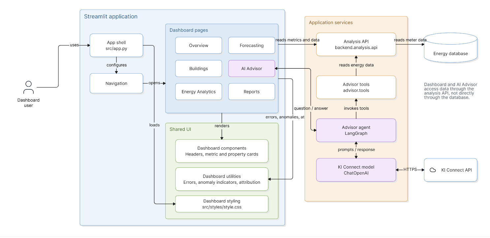

# WattLens - AI-Powered Smart Energy Management for German Properties

WattLens shows where a building's electricity goes, finds the waste, and tells you what to do about it.

It is a Python prototype built as the FH Dortmund capstone project *AI-Powered Smart Energy Management System for German Properties*.
It turns raw meter readings from real German buildings into a Streamlit dashboard with KPIs, period comparisons, reports, forecasts, and an AI energy advisor.

---

## Video

<!-- Replace the link below with the published video URL -->

**[▶ Watch the WattLens showcase video](https://drive.google.com/file/d/1vc62Jwb-Pq7q6N37rPdjqaavSLd11UnV/view?usp=sharing)**

A walkthrough covering the problem, the product, how it works, and the roadmap.

---

## Contents

- [Team](#team)
- [What it does](#what-it-does)
- [How it works](#how-it-works)
- [Data](#data)
- [Getting started - How to run the program](#getting-started)
- [Configuration](#configuration)
- [Project structure](#project-structure)
- [Backend API](#backend-api)
- [AI Advisor](#ai-advisor)
- [Testing](#testing)
- [Design](#design)
- [Roadmap](#roadmap)
- [Data licence and academic use](#data-licence-and-academic-use)

---

## Team

| Member | Matriculation number | Subsystem |
|---|---:|---|
| Shreya Patil | 7226047 | 1 · Energy Dashboard & Reporting |
| Ourvish Lofur | 7226994 | 2 · Data Management & Energy Analytics |
| Joywin Bennis | 7225872 | 3 · AI Energy Advisor & Integration |

Made @ Fachhochschule Dortmund as part of the Compact Programming Course by Professor G.Tabunshchyk

---

## What it does

| Dashboard page | What you get |
|---|---|
| **Overview** | Portfolio totals for the last 30 days or 6 months, CO₂ change, a daily consumption trend with an **unusual-use indicator**, and key insights |
| **Buildings** | All properties with type and floor area, filterable by type or name; per-building details with the latest estimated power and power per meter zone |
| **Energy Analytics** | Consumption by building and by building type, top consumers, and a comparison with the previous period of the same length |
| **Forecasting** | An hourly demand forecast per building for the next 7, 14 or 30 days, with the forecast total, peak day, daily average and a recommended action |
| **AI Advisor** | Ask questions in plain language ("Compare Home 1 and Home 3 for November 2016"). The advisor looks up real figures with tools and answers with assumptions and suggested actions |
| **Reports** | Consumption, cost and CO₂ for 30 days, 6 months, 12 months or a custom range, downloadable as **PDF** or **CSV** |

Behind the dashboard, the analytics layer also provides:
- energy, cost, CO₂ and energy-use intensity (kWh/m²/year) for any period;
- savings against the previous period;
- a 0–100 sustainability score with grades A–E;
- the share of energy used outside opening hours;
- peak-usage analysis.

---

## How it works



1. **Ingest.** The OPSD file stores running meter totals. `backend.ingestion.opsd` turns them into energy per 15-minute interval and drops intervals across data gaps. It rejects physically impossible values (negative, or above a per-building-type limit) and stores readings once only (`INSERT OR IGNORE`, so re-running is safe).
2. **Store.** One SQLite database (`energy.db`) holds buildings, zones, meters and readings, with foreign keys and checks. All times are stored as UTC.
3. **Analyse.** `backend.analysis.api` is the single entry point for the team. Pure formulas live in `backend.analysis.calc`. Periods use Berlin time, with the start included and the end excluded.
4. **Show.** The Streamlit app (`src/app.py`) calls the API for every page.
5. **Advise.** The AI advisor is a LangChain agent whose tools call the same API, so its numbers match the dashboard's.
6. **Simulate live data.** `backend.ingestion.replay` feeds December 2016 into the database one 15-minute reading at a time, so the dashboard behaves like a live system without physical meters.

---

## Data

**Source:** [Open Power System Data - Household Data](https://data.open-power-system-data.org/household_data/2020-04-15/) (version 2020-04-15). These are measured electricity time series from small businesses, public buildings and households in southern Germany, recorded as cumulative energy in kWh.

Six buildings are used. Their floor areas are not in the dataset; they are assumptions recorded in `config.toml`.

| Building | Type | OPSD column | Floor area (assumed) |
|---|---|---|---|
| Home 1 | Home | `DE_KN_residential1_grid_import` | 140 m² |
| Home 3 | Home | `DE_KN_residential3_grid_import` | 120 m² |
| Home 4 | Home | `DE_KN_residential4_grid_import` | 160 m² |
| Business 1 | Business | `DE_KN_industrial1_grid_import` | 2,500 m² |
| Business 3 | Business | `DE_KN_industrial3_grid_import` | 6,000 m² |
| Public 1 | Public | `DE_KN_public1_grid_import` | 800 m² |

The database covers 2016: about 170,000 validated 15-minute readings. January to November is loaded directly; December is fed in by the live replay.

**Assumptions, all editable in `config.toml`:**
- an electricity price of €0.30/kWh (placeholder);
- a CO₂ factor of 0.38 kg/kWh (German grid mix);
- energy-intensity benchmarks per building type;
- score weights.

These figures are illustrative, not a billing calculation.

---

## Getting started

### Prerequisites

- Python **3.14**
- About 60 MB of disk space for the OPSD file
- A KI Connect account and API key, needed for the AI Advisor page only

### 1. Clone and install

```bash
git clone https://github.com/shre-afk/Capstone_project.git
cd Capstone_project
python -m venv .venv
```

Activate the virtual environment.

Windows:
```bash
.venv\Scripts\activate
```

macOS / Linux:
```bash
source .venv/bin/activate
```

Then install the dependencies:
```bash
python -m pip install -r requirements.txt
python -m pip install -e .
```

### 2. Download the data

Download the OPSD file (60 MB, not stored in Git) into `data/raw/`:

```text
https://data.open-power-system-data.org/household_data/2020-04-15/household_data_15min_singleindex.csv
→ data/raw/household_data_15min_singleindex.csv
```

### 3. Build the database

```bash
python -m backend.ingestion.opsd
```

This takes a few seconds and is safe to repeat: existing readings are never duplicated.

### 4. Configure the AI Advisor (optional)

Copy the template and add your KI Connect credentials:

```bash
cp .env.example .env
```

```ini
KICONNECT_BASE_URL=https://chat.kiconnect.nrw/api/v1
KICONNECT_API_KEY=your-key
KICONNECT_MODEL=GPT-OSS-120B
```

`.env` is ignored by Git. Never commit API keys.

### 5. Run the dashboard

```bash
python -m streamlit run src/app.py
```

### 6. Simulate live data (optional)

In a second terminal:

```bash
python -m backend.ingestion.replay
```

Press **Ctrl+C** to stop. The replay resumes where it stopped and never loses or duplicates a reading.

---

## Configuration

| File | Holds |
|---|---|
| `config.toml` | Time zone, data period, replay speed, price, CO₂ factor, validation limits, benchmarks, score weights, and the building list |
| `.env` | KI Connect URL, API key and model for the AI Advisor |
| `.streamlit/config.toml` | Dashboard theme |
| `DB_PATH` (environment variable) | An alternative location for the SQLite database, for example inside a container volume |

Change values in `config.toml`, never in the Python code.

---

## Project structure

```text
Capstone_project/
├── .streamlit/config.toml        # dashboard theme
├── config.toml                   # every tunable value and the building list
├── .env.example                  # template for AI Advisor credentials
├── data/raw/                     # OPSD CSV (downloaded, not in Git)
├── src/
│   ├── app.py                    # Streamlit entry point and page navigation
│   ├── styles/style.css
│   ├── ui/dashboard/             # Overview, Buildings, EnergyAnalytics, Forecasting,
│   │                             # Advisor, Reports + components, anomalies, errors
│   ├── backend/                  # Data Management & Energy Analytics
│   │   ├── settings.py           # reads config.toml
│   │   ├── models.py             # Building -> Home / Business / PublicBuilding, Zone, Meter
│   │   ├── db/database.py        # SQLite schema and queries (the only file with SQL)
│   │   ├── ingestion/opsd.py     # import and validation
│   │   ├── ingestion/replay.py   # live replay
│   │   └── analysis/             # api.py (service layer), calc.py (formulas)
│   ├── advisor/                  # AI Energy Advisor: agent, model, prompts, tools, settings
│   └── data/loader.py            # OPSD loading helpers
├── tests/                        # pytest suite (backend + dashboard)
├── pyproject.toml
└── requirements.txt
```

---

## Backend API

The dashboard and the advisor use the backend only through `backend.analysis.api`:

| Function | Returns |
|---|---|
| `list_buildings()` | id, name, type, floor area for every building |
| `get_latest(building_id)` | latest reading time, estimated power (kW), power per zone |
| `get_kpis(building_id, start, end)` | energy kWh, cost €, CO₂ kg, EUI kWh/m²/yr, period days, completeness |
| `get_timeseries(building_id, start, end, freq="1h")` | kWh per zone at the chosen resolution |
| `get_savings(building_id, start, end)` | change against the previous period of the same length (kWh, €, CO₂, %) |
| `get_score(building_id, start, end)` | sustainability score 0–100, grade A–E, intensity and after-hours points |
| `get_peak_usage(building_id, start, end, top_n=5)` | highest complete hours and days, highest average clock hours, coverage |
| `get_forecast(building_id, days=7)` | hourly forecast (average of the same weekday-hour over the last 4 weeks) |

Dates without a time zone are Berlin time; `end` is excluded; invalid input raises `ValueError`. More detail is in [`src/backend/README.md`](src/backend/README.md).

---

## AI Advisor

- **Model:** any tool-calling model on KI Connect, the NRW universities' OpenAI-compatible AI gateway, via `langchain-openai`.
- **Tools:**
  - `list_buildings`
  - `get_consumption`
  - `compare_buildings`
  - `get_peak_usage`

  All of them call the backend API, so answers use the same numbers as the dashboard.
- **Memory:** each browser session has its own conversation thread, and **New conversation** starts again.
- **Guardrails** (from the system prompt):
  - it answers building-energy questions only;
  - it uses tools for building-specific figures;
  - it names the building, period, units and assumptions;
  - it keeps observed findings, possible explanations and suggested actions separate;
  - it doesn't invent results for features that aren't connected, such as forecasting in chat or anomaly detection.

---

## Testing

```bash
python -m pytest -v
```

**51 tests**, all passing:

| Area | File(s) | Tests |
|---|---|---|
| Domain model | `tests/backend/test_models.py` | 5 |
| Database | `tests/backend/test_database.py` | 4 |
| Ingestion | `tests/backend/test_ingestion.py` | 3 |
| Formulas | `tests/backend/test_calc.py` | 8 |
| Service API | `tests/backend/test_api.py` | 6 |
| Unusual-use indicator | `tests/test_dashboard_anomalies.py` | 6 |
| Dashboard error handling and components | `tests/test_dashboard_errors.py` | 19 |

The backend tests use a temporary database and a small hand-calculated fake office, so they never touch `energy.db` or the OPSD file. For coverage:

```bash
python -m pytest --cov=backend --cov-report=term-missing
```

---

## Design
All design diagrams are in the repository:

- [`UML_diagrams`](UML_diagrams/): the whole-system architecture
- [`UML_diagrams/Backend/`](UML_diagrams/Backend/): the Data Management & Energy Analytics subsystem (12 diagrams)

### System architecture



### Backend diagrams

| # | Diagram |
|---|---|
| 1 | [Backend System Design](UML_diagrams/Backend/1_Backend%20System%20Design.jpeg) |
| 2 | [OPSD Data](UML_diagrams/Backend/2_OPSD%20Data.jpeg) |
| 3 | [High-Level Architecture](UML_diagrams/Backend/3_High-Level%20Architecture.jpeg) |
| 4 | [Class Diagram](UML_diagrams/Backend/4_Class%20Diagram.jpeg) |
| 5 | [Object Diagram](UML_diagrams/Backend/5_Object%20Diagram.jpeg) |
| 6 | [Database Design](UML_diagrams/Backend/6_Database%20Design.jpeg) |
| 7 | [Flowchart - opsd.run()](UML_diagrams/Backend/7_Flowchart%20-%20opsd.run%28%29.jpeg) |
| 8 | [Flowchart - replay.run()](UML_diagrams/Backend/8_Flowchart%20-%20replay.run%28%29.jpeg) |
| 9 | [Sequence Diagram - Live data flow](UML_diagrams/Backend/9_Sequence%20Diagram%20-%20Live%20data%20flow.jpeg) |
| 10 | [Sequence Diagram - get_kpis()](UML_diagrams/Backend/10_Sequence%20Diagram%20-%20get_kpis%28%29.jpeg) |
| 11 | [Sequence Diagram - get_score](UML_diagrams/Backend/11_Sequence%20Diagram%20-%20get_score.jpeg) |
| 12 | [Connection to other team system](UML_diagrams/Backend/12_Connection%20to%20other%20team%20system.jpeg) |


---

## Roadmap

1. **Now:** the complete platform: dashboard, analytics, forecast and AI advisor.
2. **Next:**
   - seasonal anomaly alerts (unusual use for the season, day type and hour);
   - weather-corrected savings;
   - the sustainability score shown in the dashboard;
   - Docker deployment.
3. **Then:** live smart-meter connections, heat and gas meters, and several zones per building.
4. **Later:** pilots with property managers, whole-portfolio views and CO₂/ESG reporting.

---

## Data licence and academic use

The building data comes from Open Power System Data under the
[Creative Commons Attribution International licence](https://creativecommons.org/licenses/by/4.0/):

> Open Power System Data. 2020. Data Package Household Data. Version 2020-04-15.
> https://data.open-power-system-data.org/household_data/2020-04-15/ (Primary data from various sources, for a complete list see URL).

This project is an academic prototype for teaching and demonstration. Costs, intensities and scores rest on the assumptions in `config.toml`.
Forecasts and AI-generated advice describe the recorded data. They do not guarantee savings and do not diagnose equipment faults.
