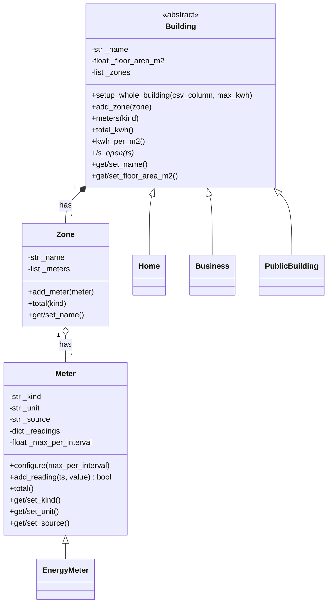
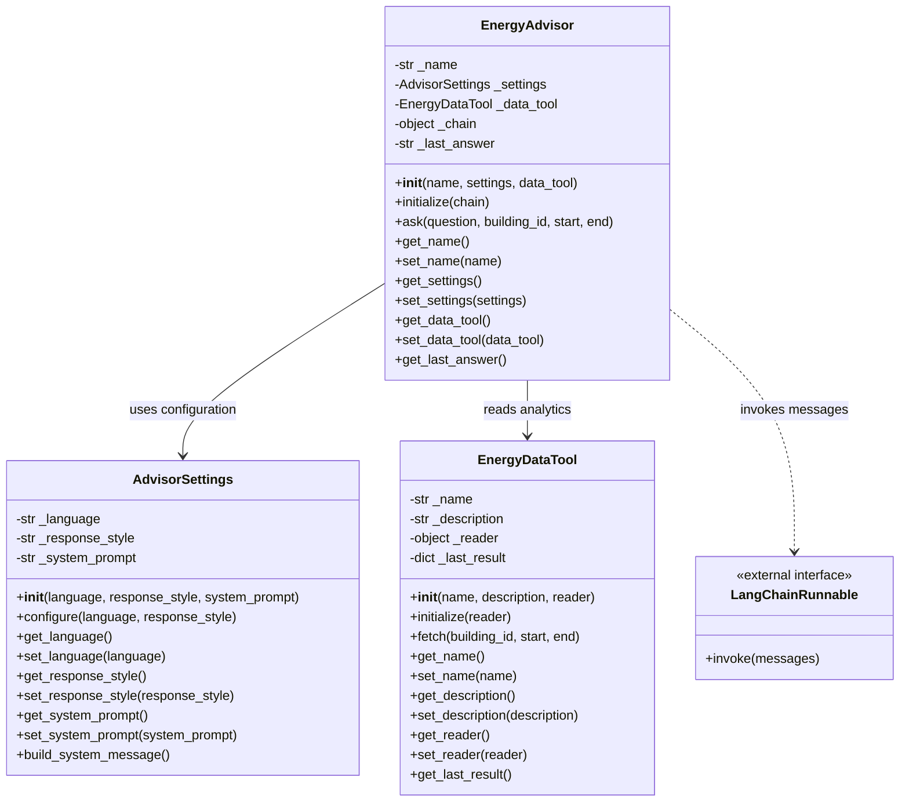

# Smart Energy Management System · Hometask 1 (OOP classes)

Group 30 · M1-05 Compact Programming Course (Python) · FH Dortmund

## Team overview

| Member        | Matr. no. | Subsystem                                 | Folder                       |
|---------------|-----------|-------------------------------------------|------------------------------|
| Shreya Patil  | 7226047   | 1 · Energy Dashboard & Reporting          | `subsystem1_dashboard/`      |
| Ourvish Lofur | 7226994   | 2 · Data Management & Energy Analytics    | `subsystem2_data_analytics/` |
| Joywin Bennis | 7225872   | 3 · AI Analyzer & Integration             | `subsystem3_ai/`             |

## System design

### Subsystem 2 · Data Management & Energy Analytics

**Ourvish Lofur · Matr. no. 7226994**

Three classes (and their subclasses) store and check all meter data:

| Class | Responsibility | Initialization/setup | Encapsulation examples |
|---|---|---|---|
| `Meter` / `EnergyMeter` | Holds one meter's 15-minute readings and refuses impossible ones (negative, above the limit, duplicate time) | `__init__` calls the setters; `configure(max_per_interval)` sets the physical limit | `get_kind` / `set_kind`, `get_unit` / `set_unit`, `get_source` / `set_source`; readings only change through `add_reading` |
| `Zone` | Groups the meters of one part of a building | `__init__`, `add_meter(meter)` | `get_name` / `set_name`, `get_meters` |
| `Building` (abstract) with `Home`, `Business`, `PublicBuilding` | A building with its zones; each type answers `is_open(ts)` with its own opening hours | `__init__` calls the setters; `setup_whole_building(csv_column, max_kwh)` creates a zone with a configured meter | `get_name` / `set_name`, `get_floor_area_m2` / `set_floor_area_m2` (rejects values <= 0) |

All attributes are private (leading underscore). Because the constructors go through the setters, even a brand-new object can't hold invalid values.

A building has zones, a zone has meters. Today every building has one zone
("Whole building") with one electricity meter; the classes already allow more.



Run Ourvish's demonstration **from the repository root**:

```bash
python hometask_assignments/hometask1/subsystem2_data_analytics/demo.py
```

The demo builds three of our real buildings (Home 1, Business 1, Public 1), gives Home 1 four readings (9.9 kWh is rejected as impossible for a home, a second 08:00 value is rejected as a duplicate), asks all three whether they are open on Saturday at 10:00 (polymorphism: only the home says yes), and shows a setter refusing a negative floor area and Python refusing to create a plain abstract `Building`. It uses only the Python standard library.

### Subsystem 3 · AI Analyzer & Integration

**Joywin Bennis · Matr. no. 7225872 · joywin.bennis004@stud.fh-dortmund.de**

Three classes implement the advisor subsystem's object-oriented architecture:

| Class | Responsibility | Initialization/setup | Encapsulation examples |
|---|---|---|---|
| `AdvisorSettings` | Language, response style, and system instructions | `__init__`, `configure` | `get_language` / `set_language`, `get_system_prompt` / `set_system_prompt` |
| `EnergyDataTool` | Read-only access to the analytics subsystem through an injected reader | `__init__`, `initialize(reader)` | Name/description/reader getters and setters; cached results returned as copies |
| `EnergyAdvisor` | Combine settings, analytical results, and a model runnable to answer a question | `__init__`, `initialize(chain)` | Name/settings/data-tool getters and setters; controlled answer retrieval |



Run Joywin's demonstration **from the repository root**:

```bash
python -m hometask_assignments.hometask1.subsystem3_ai.demo
```

The demonstration uses only the Python standard library. It constructs all three classes, initializes their collaborators, asks a question using sample KPIs, changes the language through a setter, checks that returned copies protect stored values, and shows invalid configuration being rejected.

The demo reader returns synthetic analytical results; the demo runnable produces an explicitly labeled deterministic response. No model API call is made. The advisor accepts the `invoke(messages)` interface used by LangChain chat models and string-output chains. See the [official LangChain model interface](https://docs.langchain.com/oss/python/langchain/models#invoke).

To integrate later, initialize `EnergyDataTool` with `backend.analysis.api.get_kpis` and initialize `EnergyAdvisor` with the application's configured LangChain runnable. The homework classes do not modify the existing data or dashboard implementations.

## Presentation

Team video (3 to 5 min):

**Video:** [Hometask 1 presentation (Google Drive)](https://drive.google.com/file/d/1yi4dm8Y4fErex-7-d2I_7SP2XGJRgL6T/view?usp=drive_link)  
All team videos: [Google Drive folder](https://drive.google.com/drive/folders/1eVMkck2AjgFbLdQfN-eUD_lYISwNbn4x?usp=drive_link)
