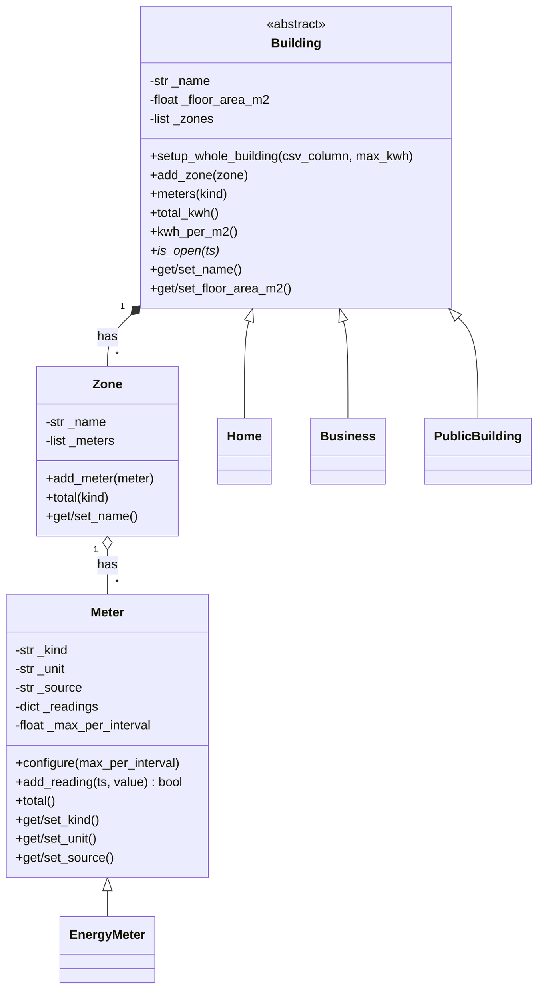

# Smart Energy Management System · Hometask 1 (OOP classes)
 
Group 30 · M1-05 Compact Programming Course (Python) · FH Dortmund
 
## Team overview
 
| Member        | Matr. no. | Subsystem                                 | Folder                       |
|---------------|-----------|-------------------------------------------|------------------------------|
| Shreya Patil  | 7226047   | 1 · Energy Dashboard & Reporting          | `subsystem1_dashboard/`      |
| Ourvish Lofur | 7226994   | 2 · Data Management & Energy Analytics    | `subsystem2_data_analytics/` |
| Joywin Bennis | 7225872   | 3 · AI Analyzer & Integration             | `subsystem3_ai/`             |
 
## System design
 
### Subsystem 2 · Data Management & Energy Analytics
 
A building has zones, a zone has meters. Today every building has one zone
("Whole building") with one electricity meter; the classes already allow more.
 

 
Run it:
 
```
cd subsystem2_data_analytics
python demo.py
```
 
## Presentation
 
Team video (3 to 5 min): TO-PASTE-THE-LINK-HERE