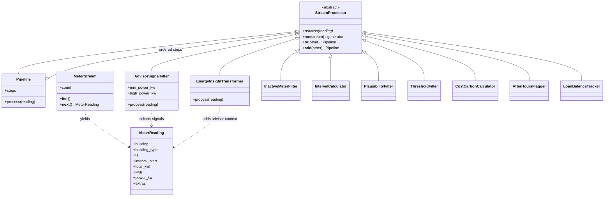

# Hometask 2 · Real-time data processing

An event-driven energy processing framework for the Smart Energy Management System. Historical quarter-hour meter counters are replayed as individual events; the demo does not require physical IoT meters.

## Team overview

| Member | Matriculation number | Assigned subsystem |
|---|---|---|
| Shreya Patil | 7226047 | Energy Dashboard & Reporting |
| Ourvish Lofur | 7226994 | Data Management & Energy Analytics |
| Joywin Bennis | 7225872 | AI Analyzer & Integration |

Ourvish's data processors are in `subsystem2_stream/`. Joywin's advisor processors are in `subsystem3_ai_stream/` and reuse the same abstract processing interface.

## Required OOP concepts

| Requirement | Implementation |
|---|---|
| Abstract base class | `StreamProcessor(ABC)` declares `process(reading)` with `@abstractmethod` |
| Inheritance and polymorphism | Data and advisor processors implement the same method; `Pipeline` invokes every stage uniformly |
| Operator overloading | `stage_a | stage_b` and `stage_a + stage_b` build a pipeline |
| Iterators | `MeterStream.__iter__` returns itself; `__next__` consumes one event and propagates `StopIteration` |
| Generators | `replay_feed()` produces events; `StreamProcessor.run()` and the advisor demo's `retained_readings()` yield results lazily |

## Processing flow

```text
replay_feed() -> MeterStream
  -> InactiveMeterFilter | IntervalCalculator | PlausibilityFilter
  -> ThresholdFilter | CostCarbonCalculator | AfterHoursFlagger | LoadBalanceTracker
  -> separate advisor output: AdvisorSignalFilter | EnergyInsightTransformer
```

The data pipeline drops missing/inactive meter reports, rejects invalid intervals, and removes usage below the configured power threshold. Accepted intervals are transformed into energy balances, estimated cost, carbon equivalents, and after-hours flags. The advisor output selects attention signals only after those balances have been computed.

## Class diagram



## Run the demos

Use Python 3.14 or later. From the repository root, no additional packages or credentials are needed:

```bash
python -m hometask_assignments.hometask2.subsystem2_stream.main
python -m hometask_assignments.hometask2.subsystem3_ai_stream.demo
```

The original direct-script invocation is also supported:

```bash
cd hometask_assignments/hometask2/subsystem2_stream
python main.py
```

## Data processing details

- Input: six buildings' cumulative meter counters in kWh, sampled every 15 minutes. The embedded sample covers 1 December 2016, 18:00–19:30 Berlin local time, with two deliberately injected faults.
- A missing counter is dropped. The first counter establishes a baseline. A new interval is trusted only when the previous valid counter is exactly 15 minutes earlier.
- Interval energy is the difference between consecutive counters. Average power is `kWh * 4` for a 15-minute interval.
- Plausibility limits are configurable by building type. The demonstration's usage threshold is **0.8 kW**: below-threshold values are dropped and equality is retained.
- Estimated cost uses **0.30 EUR/kWh** and carbon uses **0.38 kg CO2/kWh**. Both are demonstration factors, not current tariff claims.
- A counter timestamp is the **end** of its interval. `interval_start` records its beginning. Aligned quarter-hour intervals are classified using the opening status at their start: 18:45–19:00 is within business hours; 19:00–19:15 is after hours.
- Balances describe the **retained intervals after filtering**, not the building's complete consumption. They must not be presented as full consumption reports or used as an authoritative replacement for the capstone's unfiltered valid data.

## Joywin's advisor processors

### AdvisorSignalFilter

A `StreamProcessor` subclass that retains significant after-hours use or power at/above a configured building-type threshold. Default high-power thresholds are **3 kW for homes**, **80 kW for businesses**, and **20 kW for public buildings**. These are illustrative rules, not learned baselines or established equipment limits. Constructor arguments allow different thresholds.

### EnergyInsightTransformer

A `StreamProcessor` subclass that transforms selected events into `reading.extras["advisor_context"]` and a readable `advisor_message`. Context includes building/meter identifiers, the actual interval, energy, average power, estimated cost/carbon, reasons, and suggested investigations.

```python
advisor_pipeline = AdvisorSignalFilter() | EnergyInsightTransformer()
for reading in advisor_pipeline.run(retained_readings()):
    print(reading.extras["advisor_message"])
```

The output prepares factual context for a later LangChain advisor. It uses explicit rules and does not make live model calls or claim to identify the cause of an anomaly.

## Demonstration results

- **42 input readings**.
- **20 retained energy intervals**, **22 dropped** by the data pipeline.
- **7 advisor signals** and **13 retained intervals without an advisor flag**.
- Business 3 retained energy: **157.500 kWh**; after-hours portion: **48.500 kWh**.
- Advisor selection leaves the data pipeline's balances unchanged.

Example: Business 3's 18:45–19:00 interval produces a high-power signal, but no after-hours flag. Its 19:00–19:15 interval produces both flags.

## Video

Five-minute walkthrough: **link pending recording**. Add the actual video URL here and in the root README after recording.
