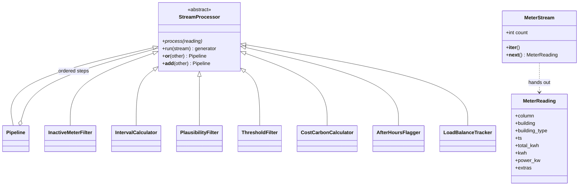
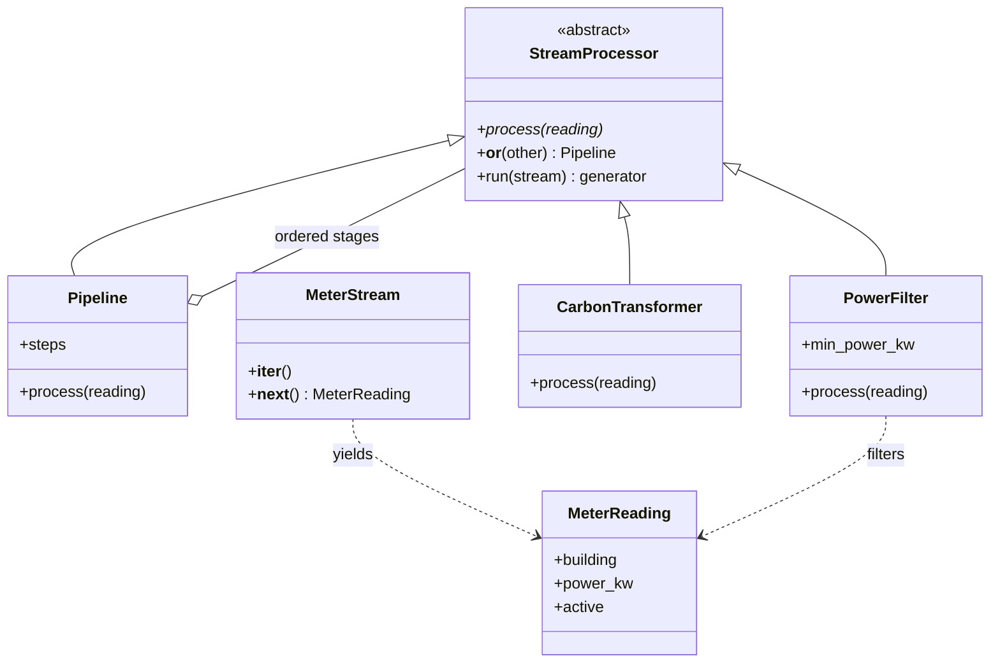

# Hometask 2 · Real-Time Data Processing

Event-driven stream processing for the Smart Energy Management System.

Team details are in the [main README](../../README.md).

| Folder | Subsystem | Implementation |
|---|---|---|
| [subsystem2_stream](subsystem2_stream/readme.md) | 2 · Data Management & Energy Analytics (Ourvish Lofur) | Replays real OPSD meter counters and turns them into checked 15-minute energy, cost and CO2 values |
| [subsystem3_ai_stream](subsystem3_ai_stream/readme.md) | 3 · AI Analyzer & Integration (Joywin Bennis) | Filters power events and converts them into energy and carbon equivalents |

The two implementations are independent: neither imports the other.

## Subsystem 2 · Data stream pipeline

**Ourvish Lofur · Matr. no. 7226994** · [subsystem README](subsystem2_stream/readme.md)

Every building's electricity meter sends its running counter every 15 minutes. `replay_feed()` replays a real slice of the OPSD data (1 December 2016, 18:00 to 19:30, our six buildings, plus two injected faults) one reading at a time, and each reading goes through the pipeline the moment it arrives.

```text
replay_feed() -> MeterStream -> InactiveMeterFilter | IntervalCalculator | PlausibilityFilter
 (generator)     (iterator)     | ThresholdFilter | CostCarbonCalculator | AfterHoursFlagger | LoadBalanceTracker
```

| Requirement | Implementation |
|---|---|
| Abstract base class | `StreamProcessor(ABC)` declares `process()` with `@abstractmethod` |
| Inheritance and polymorphism | Seven processing steps and `Pipeline` subclass `StreamProcessor`; `Pipeline` calls `process()` on each step without knowing which one it is |
| Operator overloading | `__or__` (and `__add__`) join steps into a `Pipeline`: `InactiveMeterFilter() \| IntervalCalculator() \| ...` |
| Iterator | `MeterStream` explicitly implements `__iter__` and `__next__` and counts every reading that passes |
| Generators | `replay_feed()` yields readings one by one; `run()` yields only the readings that survive |
| Filters | `InactiveMeterFilter` (silent meters), `PlausibilityFilter` (limits per building type), `ThresholdFilter` (standby below 0.8 kW) |
| Transformers | `IntervalCalculator` (counter -> kWh and kW, only across exact 15-minute gaps), `CostCarbonCalculator` (0.30 EUR and 0.38 kg CO2 per kWh), `AfterHoursFlagger`, `LoadBalanceTracker` |

### Class diagram



### Run

From the repository root (standard library only):

```bash
python hometask_assignments/hometask2/subsystem2_stream/main.py
```

Result: **42 readings come in, 20 get through.** Public 1 is dropped every time (its real meter stopped sending in November 2016), Home 3's lost 18:45 value means no interval is calculated across the gap, and Business 1's 250 kWh glitch at 19:00 and the negative value right after it are both rejected. The closing table shows energy, cost, CO2 and the after-hours share per building: Business 3 uses 47% of its energy after closing time.

## Subsystem 3 · AI stream

**Joywin Bennis · Matr. no. 7225872**

`subsystem3_ai_stream/` is self-contained. It has its own abstract processor, specialized filter and transformer, pipeline composition, iterator, and event generator. It does not import or require `subsystem2_stream/`.

| Requirement | Implementation |
|---|---|
| Abstract base class | `StreamProcessor(ABC)` declares `process()` with `@abstractmethod` |
| Inheritance and polymorphism | `PowerFilter`, `CarbonTransformer`, and `Pipeline` implement the same `process(reading)` interface |
| Operator overloading | `filter_stage | transform_stage` calls `__or__` to create a pipeline |
| Iterator | `MeterStream` explicitly implements `__iter__` and `__next__` |
| Generators | `sample_readings()` yields events and `run()` yields accepted results lazily |

### Class diagram



### Run

From the repository root, using Python 3.14 or later:

```bash
python -m hometask_assignments.hometask2.subsystem3_ai_stream.demo
```

The demo uses the Python standard library and one print statement to display the accepted results.

### Filtering and transformation

The source simulates five meter events, each representing average power over a 15-minute interval. `PowerFilter` drops inactive meters, non-finite power, and power below **0.8 kW**; equality is retained. `CarbonTransformer` converts valid power into interval energy and carbon equivalents:

```text
energy_kwh = power_kw * 0.25 hours
co2_kg = energy_kwh * 0.38 kg/kWh
```

The interval duration is fixed for this example. The emission factor is a demonstration assumption. Three records are produced: **1.0 kWh / 0.38 kg CO2**, **2.0 kWh / 0.76 kg CO2**, and **0.2 kWh / 0.076 kg CO2**. Processing happens one event at a time, with no full output list in the demo.

## Directory layout

```text
hometask_assignments/hometask2/
|-- readme.md
|-- subsystem2_stream/       # Ourvish's data stream pipeline
|   |-- reading.py          # MeterReading (one message in the stream)
|   |-- stream.py           # real OPSD counters, replay_feed generator, MeterStream iterator
|   |-- processors.py       # ABC, pipeline, 3 filters, 4 transformers
|   |-- main.py
|   `-- readme.md
`-- subsystem3_ai_stream/    # Independent energy pipeline
    |-- __init__.py
    |-- processors.py       # ABC, pipeline, filter, transformer
    |-- stream.py           # Reading object, iterator, generator
    |-- demo.py
    `-- readme.md
```

## Video

Five-minute presentation: **link pending recording**.
