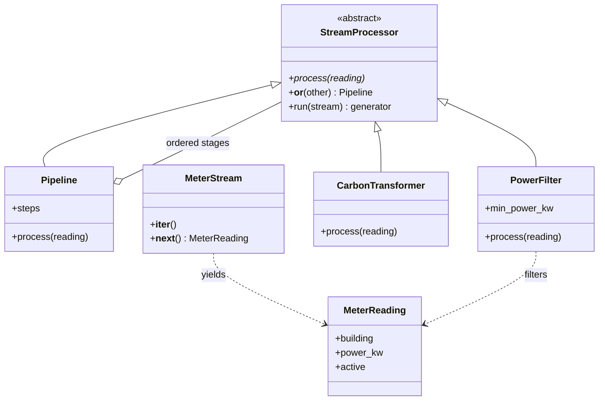

# Hometask 2 · Real-Time Data Processing

Event-driven stream processing for the Smart Energy Management System.

Team details are in the [main README](../../README.md).

## Implementation

`subsystem3_ai_stream/` is self-contained. It has its own abstract processor, specialized filter and transformer, pipeline composition, iterator, and event generator. It does not import or require `subsystem2_stream/`.

| Requirement | Implementation |
|---|---|
| Abstract base class | `StreamProcessor(ABC)` declares `process()` with `@abstractmethod` |
| Inheritance and polymorphism | `PowerFilter`, `CarbonTransformer`, and `Pipeline` implement the same `process(reading)` interface |
| Operator overloading | `filter_stage | transform_stage` calls `__or__` to create a pipeline |
| Iterator | `MeterStream` explicitly implements `__iter__` and `__next__` |
| Generators | `sample_readings()` yields events and `run()` yields accepted results lazily |

## Class diagram



## Run

From the repository root, using Python 3.14 or later:

```bash
python -m hometask_assignments.hometask2.subsystem3_ai_stream.demo
```

The demo uses the Python standard library and one print statement to display the accepted results.

## Filtering and transformation

The source simulates five meter events, each representing average power over a 15-minute interval. `PowerFilter` drops inactive meters, non-finite power, and power below **0.8 kW**; equality is retained. `CarbonTransformer` converts valid power into interval energy and carbon equivalents:

```text
energy_kwh = power_kw * 0.25 hours
co2_kg = energy_kwh * 0.38 kg/kWh
```

The interval duration is fixed for this example. The emission factor is a demonstration assumption. Three records are produced: **1.0 kWh / 0.38 kg CO2**, **2.0 kWh / 0.76 kg CO2**, and **0.2 kWh / 0.076 kg CO2**. Processing happens one event at a time, with no full output list in the demo.

## Directory layout

```text
hometask_assignments/hometask2/
|-- readme.md
|-- subsystem2_stream/       # Data stream implementation
`-- subsystem3_ai_stream/    # Independent energy pipeline
    |-- __init__.py
    |-- processors.py       # ABC, pipeline, filter, transformer
    |-- stream.py           # Reading object, iterator, generator
    |-- demo.py
    `-- readme.md
```

The subsystem 2 demo can be run with:

```bash
python hometask_assignments/hometask2/subsystem2_stream/main.py
```

## Video

Five-minute presentation: **link pending recording**.
