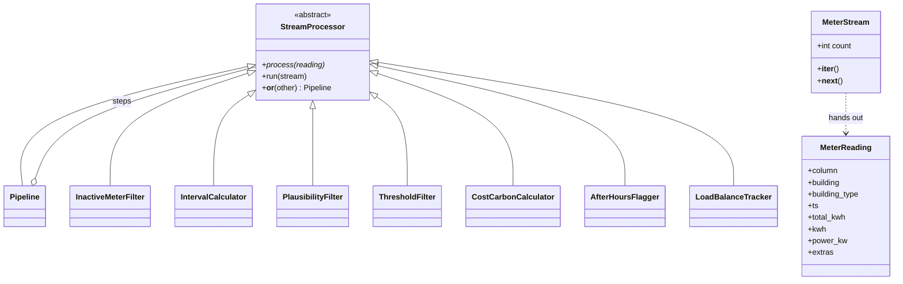

# Hometask 2 · Real-time data processing (stream pipeline)
 
The streaming version of our capstone's data import. Each building's electricity
meter sends its running counter every 15 minutes; every reading flows through a
chain of steps the moment it arrives, the way replay.py feeds December 2016 "live".
The demo replays a real slice of the OPSD data (1 Dec 2016, 18:00-19:30, our six buildings).
 
```
replay_feed() -> MeterStream -> InactiveMeterFilter | IntervalCalculator | PlausibilityFilter
(generator)     (iterator)      | ThresholdFilter | CostCarbonCalculator | AfterHoursFlagger | LoadBalanceTracker
```
 
| Concept required            | Where to find it                                          |
|-----------------------------|-----------------------------------------------------------|
| Abstract base class         | `StreamProcessor` in `processors.py` (`@abstractmethod process`) |
| Inheritance & polymorphism  | 7 processors + `Pipeline` all subclass `StreamProcessor`  |
| Operator overloading        | `__or__` (and `__add__`) build a `Pipeline`               |
| Iterators & generators      | `MeterStream.__iter__/__next__`, `replay_feed`, `run`     |
 
## Class diagram
 

 
Run it:
 
```
cd subsystem2_stream
python main.py
```
 
## Video
 
5-minute walkthrough: TO-PASTE-THE-LINK-HERE