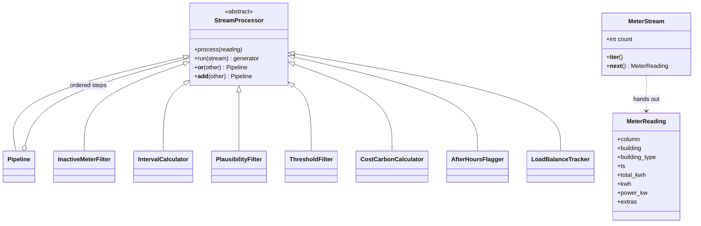

# Hometask 2 · Real-time data processing (Subsystem 2 stream pipeline)

**Author:** Ourvish Lofur · Matr. no. 7226994 · Group 30
**Subsystem:** 2 · Data Management & Energy Analytics

The streaming version of our data import. Each building's electricity meter sends its running counter every 15 minutes, and every reading flows through a chain of processing steps the moment it arrives instead of waiting for a full file. The demo replays a real slice of the OPSD data: 1 December 2016, 18:00 to 19:30, our six buildings.

```text
replay_feed() -> MeterStream -> InactiveMeterFilter | IntervalCalculator | PlausibilityFilter
 (generator)     (iterator)     | ThresholdFilter | CostCarbonCalculator | AfterHoursFlagger | LoadBalanceTracker
```

## Files

| File | What's in it |
|---|---|
| `reading.py` | `MeterReading`: one message in the stream (meter column, building, type, time, counter value) |
| `stream.py` | the recorded counters, two injected faults, the `replay_feed()` generator and the `MeterStream` iterator |
| `processors.py` | the abstract `StreamProcessor`, `Pipeline`, three filters and four transformers |
| `main.py` | builds the pipeline, prints every reading that gets through and a KPI table per building |

## Concepts

| Requirement | Implementation |
|---|---|
| Abstract base class | `StreamProcessor(ABC)` declares `process()` with `@abstractmethod` |
| Inheritance and polymorphism | Seven processing steps and `Pipeline` subclass `StreamProcessor`; `Pipeline` calls `process()` on each step without knowing which one it is |
| Operator overloading | `__or__` (and `__add__`) join steps into a `Pipeline`: `InactiveMeterFilter() \| IntervalCalculator() \| ...` |
| Iterator | `MeterStream` explicitly implements `__iter__` and `__next__` and counts every reading that passes |
| Generators | `replay_feed()` yields readings one by one; `run()` yields only the readings that survive |
| Filters | `InactiveMeterFilter` (silent meters), `PlausibilityFilter` (limits per building type), `ThresholdFilter` (standby below 0.8 kW) |
| Transformers | `IntervalCalculator` (counter -> kWh and kW, only across exact 15-minute gaps), `CostCarbonCalculator` (0.30 EUR and 0.38 kg CO2 per kWh), `AfterHoursFlagger`, `LoadBalanceTracker` |

## Class diagram



## Run

From the repository root (standard library only):

```bash
python hometask_assignments/hometask2/subsystem2_stream/main.py
```

Result: **42 readings come in, 20 get through.** Public 1 is dropped every time (its real meter stopped sending in November 2016), Home 3's lost 18:45 value means no interval is calculated across the gap, and Business 1's 250 kWh glitch at 19:00 and the negative value right after it are both rejected. The closing table shows energy, cost, CO2 and the after-hours share per building: Business 3 uses 47% of its energy after closing time.
