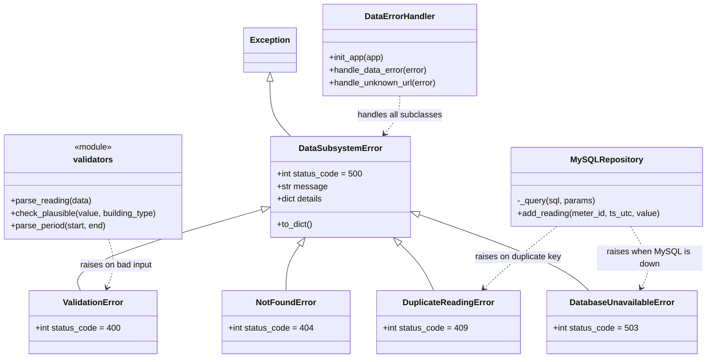

# Hometask 4 · Exception handling and automated tests

Each implementation has its own error-handling class and test suite. Team identification is in the [main README](../../README.md).

| Subsystem | Handler | Tests | Documentation |
|---|---|---:|---|
| Data Management & Analytics | `DataErrorHandler` | 15 | [Subsystem 2](subsystem2_flask/readme.md) |
| AI Analyzer & Integration | `AdvisorErrorHandler` | 15 | [Subsystem 3](subsystem3_advisor/readme.md) |

## System design

See the [advisor UML class diagram](../../README.md#advisor-uml-class-diagram) in the main README for the exception hierarchy, repository, and error handler.

### Data service exception hierarchy



Every error class carries its own HTTP status. `DataErrorHandler` registers one handler for the parent class, so through inheritance it catches every child and answers with JSON (`error`, `message`, `details`) instead of crashing. The repository translates PyMySQL's own exceptions into ours (connection lost -> 503, duplicate key -> 409), and `check_plausible` rejects impossible values (more than 5 kWh per 15 minutes for a home, 100 for a business, 50 for a public building).

## Data service test command

Install `subsystem2_flask/requirements.txt`, then run from the repository root:

```bash
cd hometask_assignments/hometask4/subsystem2_flask
python -m pytest -v
```

The tests import `app` and `repository` directly, so pytest has to be started inside that folder. The suite has 3 tests for the error classes, 5 for the validation rules and 7 for the whole API through Flask's test client. It runs on an in-memory repository (including one that simulates MySQL going down), so no MySQL is needed. Recorded result: **15 passed**.

## Advisor test command

From the repository root, install `subsystem3_advisor/requirements.txt`, then run:

```bash
python -m pytest hometask_assignments/hometask4/subsystem3_advisor/tests -q
```

The advisor suite checks normal web output, advice rules, invalid summaries, missing resources, safe server errors, parameterized SQL, and connection cleanup. It runs without MySQL using local fixtures and mocked connections. Recorded result: **15 passed**.

The two implementations are independent. Their production data and application files are contained in their respective folders.
